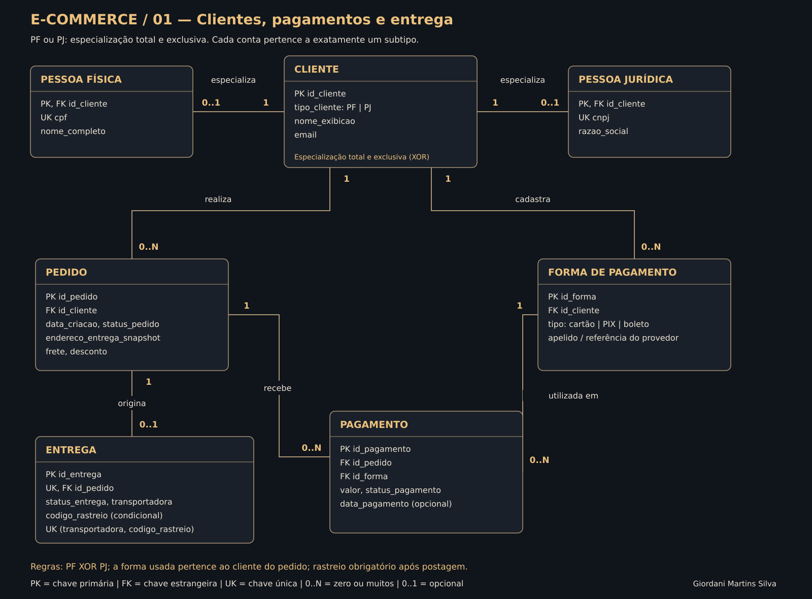
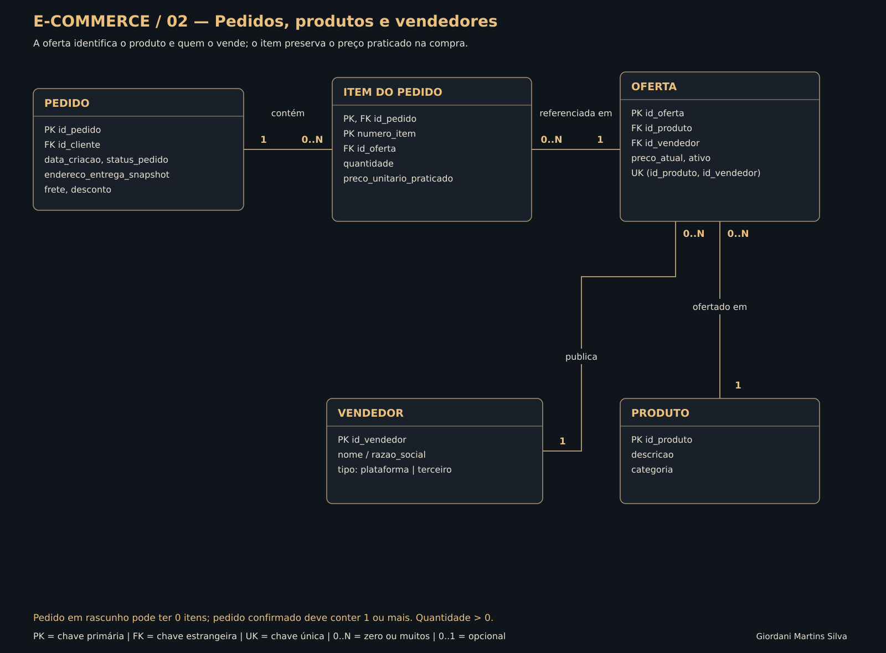
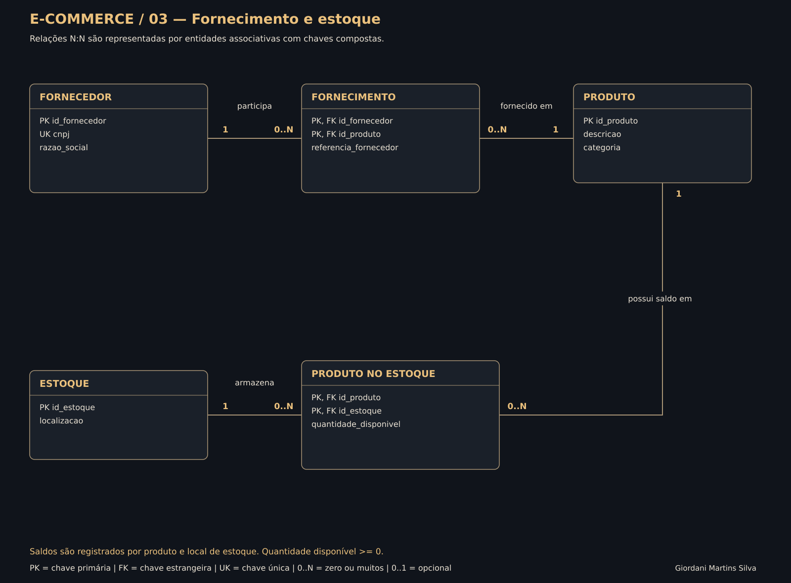

# Refinando um Projeto Conceitual de Banco de Dados — E-commerce

**Autor:** Giordani Martins Silva  
**Formação:** SQL Database Specialist — DIO  
**Entregável principal:** esquema conceitual refinado, com cardinalidades, regras de negócio e arquivo editável no Draw.io.

O modelo representa clientes, pedidos, produtos, vendedores, fornecedores e estoques. O refinamento atende aos três requisitos escritos da DIO: conta exclusivamente PF ou PJ, cadastro de mais de uma forma de pagamento e entrega com status e código de rastreio.

A representação usa entidades, atributos, cardinalidades e anotações de PK/FK/UK. A própria página de informações do desafio permite essa variação próxima ao diagrama entidade-relacionamento usado por Workbench e DBDesigner. As chaves são uma indicação do futuro mapeamento relacional; o foco da entrega é a modelagem, não a implementação SQL.

## Diagramas

### 1. Clientes, pagamentos e entrega



### 2. Pedidos, produtos e vendedores



### 3. Fornecimento e estoque



As três imagens são recortes do mesmo modelo. CLIENTE, PEDIDO e PRODUTO mantêm a mesma identidade quando aparecem em páginas diferentes; não representam entidades duplicadas.

## Como os refinamentos foram atendidos

| Requisito do desafio | Solução adotada |
| --- | --- |
| Uma conta pode ser PF ou PJ, mas não ambas | CLIENTE possui especialização **total e exclusiva (XOR)** em PESSOA FÍSICA e PESSOA JURÍDICA. Cada conta possui exatamente um subtipo, consistente com `tipo_cliente` |
| Mais de uma forma de pagamento cadastrada | CLIENTE se relaciona com FORMA DE PAGAMENTO em 1 para 0..N. Cada forma pertence a um único cliente |
| Entrega com status e código de rastreio | ENTREGA possui `status_entrega`, `transportadora` e `codigo_rastreio`. O código é obrigatório a partir da postagem; durante a preparação pode estar ausente |

A cardinalidade 0..1 de cada subtipo isoladamente não basta para impor a exclusividade. A anotação **total + XOR**, visível no primeiro diagrama, exige que a soma dos subtipos de cada cliente seja exatamente um. Essa é uma restrição conceitual que precisa ser implementada explicitamente ao transformar o modelo em banco físico.

## Decisões de modelagem

- **Forma cadastrada e pagamento realizado são entidades diferentes.** O cliente pode manter cartão, PIX ou boleto como meios de pagamento. PAGAMENTO registra a utilização de um desses meios em um pedido, seu valor e seu status.
- **Um pedido pode ter mais de um pagamento.** Isso permite divisão de valores ou novas tentativas; a forma utilizada deve pertencer ao mesmo cliente do pedido.
- **Pedido em rascunho pode ter zero itens.** Para confirmar o pedido, deve existir pelo menos um item válido.
- **Uma entrega por pedido.** O pedido pode ainda não ter entrega enquanto está em rascunho ou processamento. Divisão em múltiplas remessas é uma evolução possível, fora desta versão.
- **OFERTA identifica produto e vendedor.** Cada item aponta para uma oferta, permitindo produtos vendidos pela própria plataforma ou por terceiros sem confundir vendedor com fornecedor.
- **O preço de compra fica no item.** Alterar o preço atual da oferta não muda compras antigas. Produto e vendedor de uma oferta já utilizada em pedido não podem ser alterados.
- **O endereço do pedido é uma cópia histórica.** Alterar o cadastro do cliente não altera o endereço de pedidos já realizados.
- **Fornecimento e saldo em estoque são relações N:N.** As entidades associativas registram o par fornecedor/produto e o par produto/estoque sem repetições.

As escolhas adicionais são hipóteses deste projeto, detalhadas em [regras de negócio](docs/REGRAS_NEGOCIO.md), e não novas exigências atribuídas à DIO.

## Arquivos

| Arquivo | Finalidade |
| --- | --- |
| `diagramas/ecommerce_refinado.drawio` | Arquivo editável com as três páginas do esquema |
| `diagramas/diagrama_01.svg` | Visualização do refinamento exigido |
| `diagramas/diagrama_02.svg` | Relações entre pedidos, produtos e vendedores |
| `diagramas/diagrama_03.svg` | Fornecimento e estoques |
| `modelo.json` | Fonte única de entidades, atributos, relacionamentos e posições |
| `scripts/gerar_diagramas.py` | Geração reproduzível dos SVGs e do Draw.io |
| `docs/REGRAS_NEGOCIO.md` | Restrições e cardinalidades explicadas |
| `docs/DICIONARIO.md` | Dicionário das 15 entidades |
| `docs/REQUISITOS_DIO.md` | Origem e distinção entre requisitos oficiais e decisões autorais |
| `docs/REVISAO.md` | Verificações estruturais e revisão visual realizadas |

## Abrir e editar

1. Baixe o arquivo `diagramas/ecommerce_refinado.drawio`.
2. No [Draw.io / diagrams.net](https://app.diagrams.net/), selecione **Abrir diagrama existente** e escolha o arquivo.
3. Use as três abas inferiores para alternar entre os recortes do modelo.

Para apenas consultar, as imagens SVG aparecem acima e podem ser abertas individualmente para ampliar.

Para regenerar os arquivos a partir de `modelo.json`, use Python 3, sem dependências adicionais:

```sh
python scripts/gerar_diagramas.py
```

A execução confere referências de entidades, chaves e cobertura dos 15 relacionamentos, além da integridade XML dos arquivos produzidos. Não cria um banco de dados nem executa regras em um SGBD.

## Entrega na DIO

**Link do projeto:**

https://github.com/1giordani/aula-git/tree/projeto-ecommerce-conceitual/projeto-ecommerce-conceitual

**Descrição para copiar na plataforma:**

> Modelo conceitual refinado de um e-commerce, com especialização exclusiva de clientes em pessoa física ou jurídica, cadastro de múltiplas formas de pagamento e entrega com status e código de rastreio. Inclui entidades e relacionamentos de pedidos, itens, produtos, vendedores, fornecedores e estoques, com cardinalidades e regras de negócio documentadas. O projeto apresenta diagramas SVG, arquivo editável no Draw.io e documentação das decisões de modelagem.

## Fonte e escopo

Os requisitos foram consultados diretamente nas abas **Instruções para sua entrega** e **Informações** da DIO, em 19/10/2026. O vídeo não foi transcrito nem usado como fonte de detalhes não confirmados. O esquema é uma elaboração autoral a partir do enunciado escrito e não uma reprodução exata do desenho exibido em aula. Consulte [a origem dos requisitos](docs/REQUISITOS_DIO.md).
