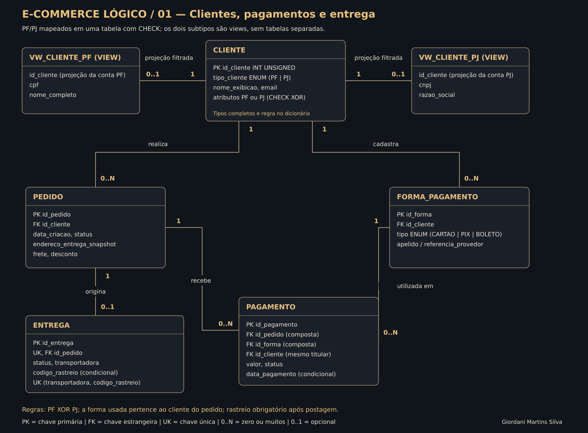
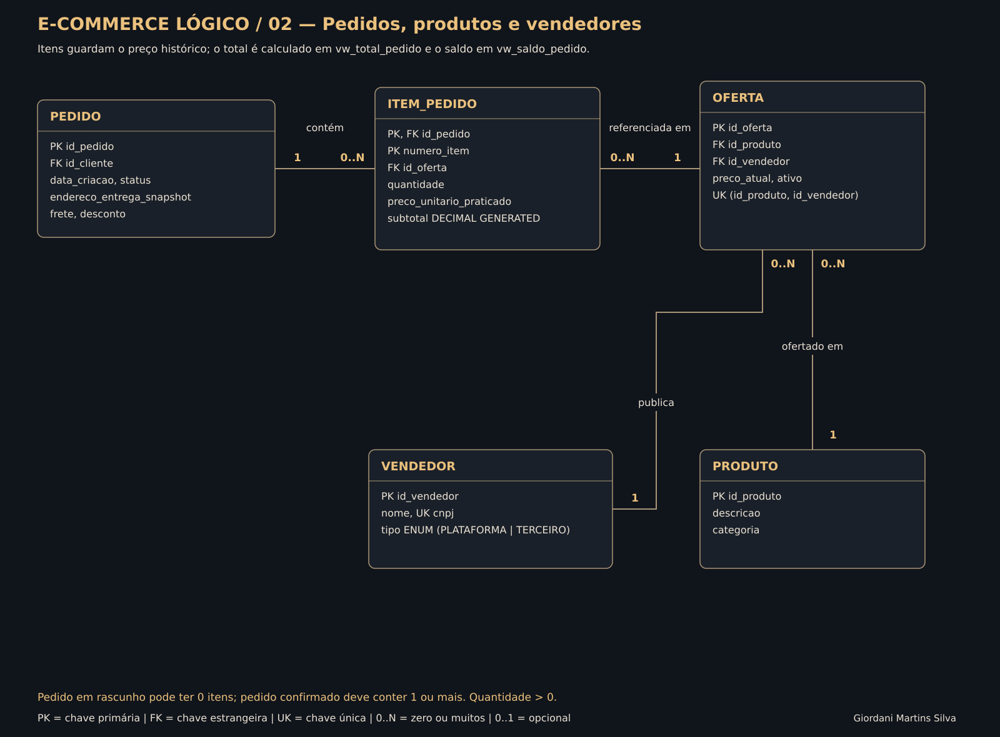
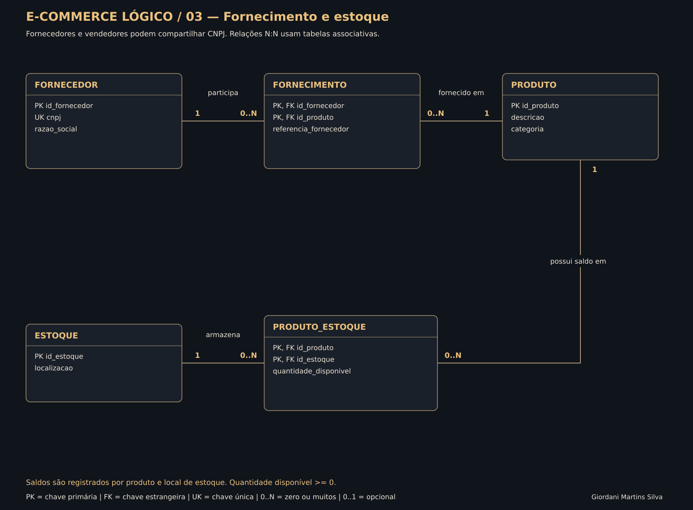

# Primeiro projeto lógico de banco de dados — E-commerce

**Autor:** Giordani Martins Silva  
**Formação:** SQL Database Specialist — DIO  
**SGBD testado:** MySQL Community Server 8.4.6, InnoDB.

Implementação relacional do [modelo conceitual refinado de e-commerce](https://github.com/1giordani/aula-git/tree/projeto-ecommerce-conceitual/projeto-ecommerce-conceitual), com clientes, ofertas, produtos, vendedores, fornecedores, estoques, pedidos, pagamentos e entregas.

O projeto inclui scripts de criação, chaves e constraints, dados fictícios, 16 perguntas respondidas por SQL e testes reais. Os requisitos seguem o enunciado fornecido pelo usuário, com [referência ao desafio da DIO](https://web.dio.me/lab/construindo-seu-primeiro-projeto-logico-de-banco-de-dados/learning/95807ea4-331e-446c-ac2d-dfc41738f206?back=/track/formacao-sql-db-specialist). A implementação é autoral, não uma cópia exata de um script de aula não fornecido.

## Esquema lógico







Os recortes representam um único esquema. Os dois subtipos de cliente aparecem como **views**, não tabelas. As ligações entre CLIENTE e essas projeções indicam filtragem, não FKs físicas. Os tipos completos, campos e chaves estão no [dicionário extraído do banco](docs/DICIONARIO.md). O arquivo [ecommerce_logico.drawio](diagramas/ecommerce_logico.drawio) permite editar as três páginas.

## Refinamentos e mapeamento EER

| Requisito | Implementação |
| --- | --- |
| Conta exclusivamente PF ou PJ | Uma tabela cliente com tipo obrigatório e CHECK que exige os atributos do tipo escolhido e proíbe os do outro |
| Mais de uma forma de pagamento | Relação 1:N entre cliente e forma_pagamento |
| Forma precisa pertencer ao cliente do pedido | Duas FKs compostas em pagamento, usando o mesmo id_cliente |
| Entrega com status e rastreio | Tabela entrega, estados definidos e CHECK que exige transportadora/código após postagem |
| Relações N:N | Tabelas fornecimento, produto_estoque, oferta e item_pedido |

A especialização EER total e exclusiva foi mapeada por **tabela única com discriminador**. PF exige CPF e nome completo, sem CNPJ/razão social; PJ exige CNPJ e razão social, sem CPF/nome completo. O CHECK inclui IS NOT NULL explícitos para não aceitar campos ausentes por uma expressão SQL de resultado UNKNOWN.

As views `vw_cliente_pf` e `vw_cliente_pj` apresentam os atributos específicos. Não há duas tabelas de subtipo que precisariam de sincronização adicional para garantir que cada cliente estivesse em exatamente uma delas.

O projeto verifica tamanho e unicidade dos documentos, mas não dígitos verificadores ou autenticidade cadastral. Todos os documentos e cadastros da demonstração são fictícios.

## Principais regras e decisões

- **13 tabelas, quatro views e 12 triggers.** As tabelas preservam PKs, FKs, chaves únicas e CHECKs. As views abrangem os subtipos e os cálculos de total/saldo.
- **Vendedor e fornecedor são papéis distintos.** O mesmo CNPJ nas duas tabelas identifica a empresa com ambos os papéis; os nomes não são usados como identificador.
- **Preço histórico.** O item copia o preço de uma oferta ativa ao ser incluído. Mudanças futuras no catálogo não alteram compras antigas.
- **Confirmação congela o pedido.** Itens, frete, desconto e endereço deixam de ser editáveis após a confirmação.
- **Pagamentos divididos.** O pedido pode ter vários pagamentos; só os aprovados reduzem o saldo. A soma aprovada não pode superar o total.
- **Quitação e entrega.** Processamento exige quitação; conclusão exige entrega realizada. Cada pedido possui no máximo uma entrega nesta versão.
- **Histórico preservado.** Pagamentos finalizados não são alterados; pagamentos e entregas não são excluídos pelos comandos comuns do projeto. Rastreio fica preservado após postagem.
- **Saldo de estoque.** Representa a posição de produtos por local, sem reserva ou baixa automática por compra nesta versão.

Consulte [mapeamento e regras](docs/MAPEAMENTO_EER.md) para transições de estado, adaptações do conceitual e limitações, incluindo ausência de estornos e remessas parciais.

## Valores derivados e cuidado com junções

```text
Subtotal do item = quantidade × preço unitário praticado
Total do pedido  = soma dos itens + frete − desconto
Valor aprovado   = soma dos pagamentos com status APROVADO
Saldo pendente   = máximo entre total − valor aprovado e zero
```

Subtotal é uma coluna gerada. Total e saldo são views, porque dependem de linhas de outras tabelas. Itens e pagamentos são agregados separadamente antes da junção, evitando somar valores repetidos quando um pedido possui vários itens e pagamentos.

A consulta detalhada de fornecedores e estoques, Q04, também pode repetir um saldo por fornecedor. Ela é uma relação descritiva; a soma física correta está na Q09, que não junta fornecedores.

## Consultas e perguntas

Todas estão em `sql/04_consultas.sql`.

| Consulta | Pergunta | Recursos SQL |
| --- | --- | --- |
| Q01 | Quantos pedidos cada cliente fez, incluindo quem não tem pedidos? | SELECT, LEFT JOIN, COUNT, GROUP BY, ORDER BY |
| Q02 | Algum vendedor também é fornecedor? | JOIN por CNPJ |
| Q03 | Quais fornecedores fornecem quais produtos? | Múltiplos JOINs |
| Q04 | Como produtos, fornecedores e locais de estoque se relacionam? | LEFT JOINs, COALESCE |
| Q05 | Quais pedidos confirmados ainda têm saldo a pagar? | WHERE, valores derivados, ORDER BY |
| Q06 | Qual o total com produtos, frete e desconto? | Agregação em view, expressão aritmética, ORDER BY |
| Q07 | Quais clientes têm mais de uma forma cadastrada? | GROUP BY, HAVING |
| Q08 | Qual o status das entregas e seus rastreios? | JOIN entre pedido, cliente e entrega |
| Q09 | Qual o saldo total de cada produto? | LEFT JOIN, SUM, COALESCE |
| Q10 | Quais vendedores somam pelo menos R$ 100 em itens de pedidos confirmados ou posteriores? | WHERE, SUM, GROUP BY, HAVING |
| Q11 | Quais contas são PF/PJ e qual o documento de cada uma? | CASE, SELECT, ORDER BY |
| Q12 | Quais clientes ainda não têm pedidos? | Subconsulta correlacionada, NOT EXISTS |
| Q13 | Quais itens preservaram preço diferente da oferta atual? | JOIN, WHERE, subtração |
| Q14 | Qual o ranking dos produtos por unidades em pedidos válidos? | CTE, CASE, DENSE_RANK |
| Q15 | Quanto foi registrado em cada status de pagamento? | GROUP BY, COUNT, SUM |
| Q16 | Quantos itens e pagamentos existem por pedido, sem duplicar totais? | Subconsultas agregadas, JOINs, views |

As quatro perguntas sugeridas pelo enunciado estão cobertas em Q01 a Q04. O conjunto atende SELECT, WHERE, expressões derivadas, ORDER BY, HAVING e junções, além de CTE, função de janela e subconsultas.

## Dados e resultados esperados

A massa contém cinco clientes (três PF e dois PJ), seis formas de pagamento, três vendedores, três fornecedores, cinco produtos, seis ofertas, três locais de estoque e seis pedidos.

| Pedido | Estado | Total | Aprovado | Saldo |
| --- | --- | ---: | ---: | ---: |
| 1001 | CONCLUIDO | 320,00 | 320,00 | 0,00 |
| 1002 | EM_PROCESSAMENTO | 930,00 | 930,00 | 0,00 |
| 1003 | CONFIRMADO | 290,00 | 100,00 | 190,00 |
| 1004 | RASCUNHO | 0,00 | 0,00 | 0,00 |
| 1005 | CANCELADO | 95,00 | 0,00 | 95,00 |
| 1006 | CONFIRMADO | 120,00 | 60,00 | 60,00 |

O saldo exibido para pedido cancelado é apenas a diferença aritmética; não representa valor a cobrar. A Q05 restringe a análise a pedidos confirmados. Valores de pedidos também não são automaticamente receita recebida.

- **Parceiro Multi** é vendedor e fornecedor pelo mesmo CNPJ.
- **Cliente Ana** tem duas formas cadastradas e pagou o pedido 1001 em duas partes.
- O pedido 1003 possui uma tentativa pendente de 190,00, que não entra no valor aprovado.
- O total aprovado da massa é **1.410,00**; a recusa de 95,00 fica separada.
- **Cliente Eva** não fez pedidos; Webcam não tem fornecimento ou saldo físico cadastrado.
- A oferta de um teclado passa de 150,00 para 160,00 após a compra, mantendo o item histórico em 150,00.

## Executar

Requisitos: MySQL Server 8.0.16+ ou 8.4, cliente mysql ou Workbench e uma conta de laboratório com privilégios para criar banco, tabelas, views e triggers. Use modo SQL estrito, como na execução validada. Python 3 é necessário apenas para os testes e a geração dos diagramas.

Em um servidor sem o banco `ecommerce_logico`, execute uma vez e nesta ordem:

1. `sql/01_estrutura.sql`
2. `sql/02_regras.sql`
3. `sql/03_dados.sql`
4. `sql/04_consultas.sql`
5. Opcional: `sql/05_fluxo_exemplo.sql`, que percorre o fluxo completo e termina em ROLLBACK.

Os arquivos não apagam bancos existentes. Não repita a carga no mesmo banco.

No CMD do Windows ou Bash:

```sh
mysql -u root -p < sql/01_estrutura.sql
mysql -u root -p < sql/02_regras.sql
mysql -u root -p < sql/03_dados.sql
mysql -u root -p < sql/04_consultas.sql
```

O redirecionamento `<` acima não funciona da mesma forma no PowerShell; use Workbench ou o teste Python.

### Testes automatizados

Em outro servidor de laboratório sem esse banco, copie `mysql-local.example.ini` para `mysql-local.ini` e ajuste as credenciais. O arquivo com a senha é ignorado pelo Git.

```sh
python scripts/testar_projeto.py --config mysql-local.ini
```

Se necessário, acrescente `--mysql` com o caminho completo do executável. O teste cria o banco e os dados; não o execute depois da criação manual no mesmo servidor.

Os testes passaram no MySQL 8.4.6, incluindo 16 consultas e 39 cenários negativos. Resultados e metadados estão em `evidencias/`; consulte [validação](docs/VALIDACAO.md) para escopo e limites. Não foram realizados testes de carga ou concorrência.

## Arquivos

- `sql/`: criação, regras, dados, perguntas e fluxo transacional.
- `diagramas/`: três SVGs e Draw.io editável.
- `docs/`: dicionário, mapeamento EER, regras e validação.
- `evidencias/`: resultados reais e metadados extraídos do MySQL.
- `scripts/testar_projeto.py`: teste de integração.
- `scripts/gerar_diagramas.py` e `modelo_logico.json`: fonte reproduzível dos diagramas.

## Entrega na DIO

**Link para entregar:**

https://github.com/1giordani/aula-git/tree/projeto-ecommerce-logico/projeto-ecommerce-logico

**Descrição para copiar:**

> Projeto lógico de banco de dados MySQL para e-commerce, com mapeamento EER de clientes exclusivamente PF ou PJ, múltiplas formas de pagamento e entregas com status e rastreio. Inclui tabelas, chaves, constraints, dados fictícios e 16 consultas com SELECT, WHERE, atributos derivados, ORDER BY, HAVING e JOIN. Os scripts foram testados no MySQL 8.4, com diagramas, documentação e evidências no GitHub.
