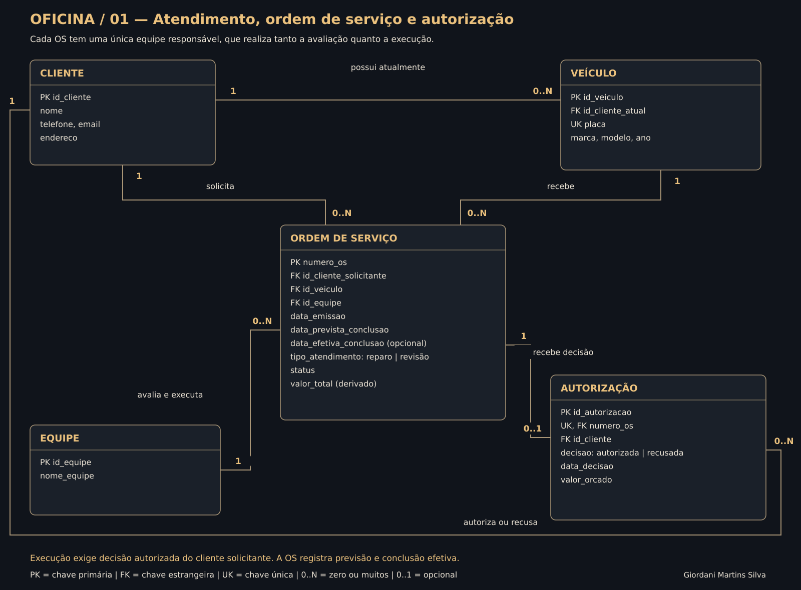
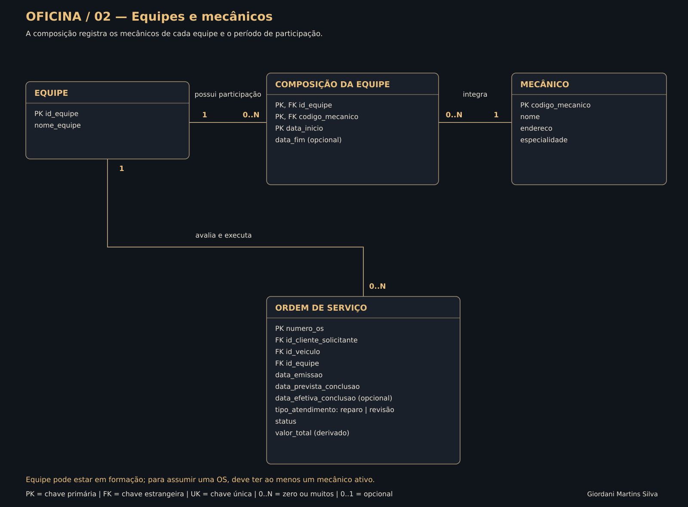

# Construindo um esquema conceitual do zero — Oficina mecânica

**Autor:** Giordani Martins Silva  
**Desafio DIO:** modelagem conceitual de controle e execução de ordens de serviço em uma oficina mecânica.

O sistema proposto registra os clientes e seus veículos, a equipe responsável por cada atendimento, os mecânicos que a compõem, os serviços e peças que integram a ordem de serviço e a decisão do cliente sobre sua execução.

O entregável é um modelo conceitual autoral, elaborado a partir da narrativa fornecida. Os diagramas indicam atributos, cardinalidades e chaves para facilitar a interpretação e um futuro mapeamento relacional. Não é uma implementação SQL nem uma reprodução de um desenho apresentado em aula.

## Esquema

### 1. Atendimento, OS e autorização



### 2. Equipes e mecânicos



### 3. Serviços, peças e valor da OS


Os três recortes pertencem a um único esquema. Entidades repetidas, como ORDEM DE SERVIÇO e EQUIPE, representam a mesma entidade em todas as páginas.

## Correspondência com a narrativa

| Elemento da narrativa | Representação |
| --- | --- |
| Clientes levam veículos para consertos ou revisões | CLIENTE possui VEÍCULO; a OS identifica o veículo, o solicitante e o tipo de atendimento (reparo ou revisão) |
| Veículo é designado a uma equipe | A equipe é atribuída na OS, permitindo equipes diferentes em visitas futuras do mesmo veículo |
| Mesma equipe avalia e executa | Uma única FK `id_equipe` na OS, com relacionamento **avalia e executa** |
| Equipe identifica serviços e preenche OS | SERVIÇO DA OS vincula o serviço de referência ao número da OS |
| Serviço é calculado pela referência de mão de obra | SERVIÇO / MÃO DE OBRA mantém descrição, unidade de cobrança e valor de referência |
| Peças compõem o valor | PEÇA DA OS registra quantidade e valor unitário aplicado de cada peça |
| Cliente autoriza execução | AUTORIZAÇÃO associa a decisão à OS e ao cliente; execução exige decisão favorável |
| Mecânico tem código, nome, endereço e especialidade | Esses quatro atributos constam em MECÂNICO |
| OS tem número, emissão, valor, status e conclusão | Esses atributos constam em ORDEM DE SERVIÇO, com previsão de conclusão e conclusão efetiva separadas |

## Decisões e hipóteses do projeto

A narrativa deixa alguns pontos em aberto. As decisões abaixo são autorais e fazem parte das regras documentadas:

1. **Equipe por atendimento.** Não existe uma equipe permanente no cadastro do veículo. O vínculo fica na OS, que representa a visita à oficina.
2. **Composição da equipe.** Uma associação N:N registra os mecânicos e os períodos em que participam de cada equipe. A equipe pode estar em formação, mas precisa ter ao menos um mecânico ativo para receber uma OS. Sua composição e seu identificador ficam preservados durante a OS aberta.
3. **Cliente solicitante histórico.** O veículo tem um cliente atual, mas a OS guarda seu próprio solicitante. Uma troca de proprietário posterior não modifica ordens antigas. Nesta versão, o solicitante precisa ser o cliente atual do veículo na abertura da OS.
4. **Autorização explícita.** Antes de o cliente decidir, a OS pode não ter autorização. A decisão final é autorizada ou recusada; uma recusa leva ao cancelamento. Uma autorização aprovada pertence ao mesmo cliente solicitante da OS.
5. **Uma decisão por OS.** Nesta versão, o orçamento autorizado fica congelado. Mudanças posteriores de escopo ou de preço exigem uma nova OS e nova decisão, em vez de substituir silenciosamente o que o cliente aprovou.
6. **Valores históricos.** O catálogo contém preços atuais de referência. Cada item da OS conserva o valor unitário aplicado ao orçamento, para que atualizações do catálogo não alterem ordens anteriores.
7. **Composição do valor.** Serviços e peças resolvem relações N:N por entidades associativas. Um mesmo serviço ou uma mesma peça aparece uma vez por OS, com sua quantidade acumulada.
8. **Itens mínimos.** Uma OS recém-aberta pode ainda não ter itens. Para aguardar autorização, precisa conter ao menos um serviço. Peças são opcionais.
9. **Datas distintas.** `data_prevista_conclusao` representa a data prometida de entrega/conclusão; `data_efetiva_conclusao` registra quando os trabalhos realmente terminaram.

O detalhamento está em [regras de negócio](docs/REGRAS_NEGOCIO.md). O [dicionário](docs/DICIONARIO.md) explica as 11 entidades e suas chaves.

## Cálculo do valor

```text
Subtotal do serviço = quantidade × valor unitário aplicado
Subtotal da peça    = quantidade × valor unitário aplicado
Valor total da OS   = soma dos serviços + soma das peças
```

Para serviço cobrado por hora, a quantidade é o número de horas previsto; para serviço de preço fixo, é a quantidade de execuções. O valor unitário é copiado da referência na montagem do orçamento. Nesta versão, não há negociação de preço, descontos, impostos ou taxas adicionais.

**Exemplo ilustrativo:** uma troca de pastilhas com mão de obra de R$ 120,00 e duas peças de R$ 80,00 produz OS de **R$ 280,00**. Esse é o valor submetido à decisão do cliente. Os números são exemplos, não valores de mercado.

O total aparece no modelo como atributo derivado. Se for armazenado fisicamente no futuro, deverá permanecer consistente com seus itens.

## Fluxo previsto

1. Cadastrar cliente e veículo e abrir a OS com equipe e previsão de conclusão.
2. A equipe avalia o veículo e identifica serviços e peças.
3. Consultar as referências e registrar quantidades e preços aplicados nos itens da OS.
4. Calcular o valor e apresentar o orçamento ao cliente solicitante.
5. Registrar a decisão. Se autorizado, a mesma equipe executa o escopo aprovado; se recusado, a OS é cancelada.
6. Concluir os trabalhos e preencher a data efetiva de conclusão.

Os status propostos são: **em avaliação, aguardando autorização, autorizada, em execução, concluída e cancelada**. A narrativa exige status, mas não define seus nomes; esses valores são uma escolha do projeto.

## Arquivos e edição

| Arquivo | Finalidade |
| --- | --- |
| `diagramas/oficina_mecanica.drawio` | Esquema editável com três páginas |
| `diagramas/diagrama_01.svg` | Atendimento, OS e autorização |
| `diagramas/diagrama_02.svg` | Equipes, participações e mecânicos |
| `diagramas/diagrama_03.svg` | Serviços, peças e cálculo |
| `modelo.json` | Fonte das entidades, atributos, relacionamentos e posições |
| `scripts/gerar_diagramas.py` | Geração dos SVGs e do Draw.io com Python 3 |
| `docs/REGRAS_NEGOCIO.md` | Restrições, cardinalidades e hipóteses |
| `docs/DICIONARIO.md` | Descrição das entidades e chaves |
| `docs/REVISAO.md` | Verificações estruturais e visuais realizadas |

Para editar, baixe `diagramas/oficina_mecanica.drawio` e abra-o no [Draw.io / diagrams.net](https://app.diagrams.net/), escolhendo **Abrir diagrama existente**. As três abas inferiores mostram as páginas do modelo. Para consultar, basta abrir as imagens acima.

Para regenerar os arquivos a partir do JSON, com Python 3 e sem bibliotecas adicionais:

```sh
python scripts/gerar_diagramas.py
```

O gerador confere entidades, chaves e referências, além de verificar o XML produzido. Essa validação não executa regras em um SGBD.

## Entrega na DIO

**Link do projeto:**

https://github.com/1giordani/aula-git/tree/projeto-oficina-conceitual/projeto-oficina-conceitual

**Descrição para copiar na plataforma:**

> Modelo conceitual de uma oficina mecânica para controle de ordens de serviço, clientes, veículos, equipes e mecânicos. Inclui autorização do cliente, serviços calculados pela referência de mão de obra e peças que compõem o valor da OS. A mesma equipe é responsável pela avaliação e execução, com datas, status, cardinalidades e regras de negócio documentados. O projeto apresenta diagramas SVG e arquivo editável no Draw.io.

## Fonte e limites

A fonte é a narrativa do desafio **Construindo um Esquema Conceitual do Zero**, fornecida pelo usuário nesta conversa, com [referência à página da DIO](https://web.dio.me/lab/construindo-um-esquema-conceitual-do-zero/learning/dc17e958-fada-4450-b1c2-d89cc7afabd0?back=/track/formacao-sql-db-specialist).

Esta entrega é conceitual: não foi criada uma base MySQL e não se afirma que as regras tenham sido testadas como constraints de um banco. Estoque, compras de peças, pagamentos, faturamento, garantias e agenda de capacidade dos mecânicos estão fora do escopo da narrativa adotado nesta versão.
