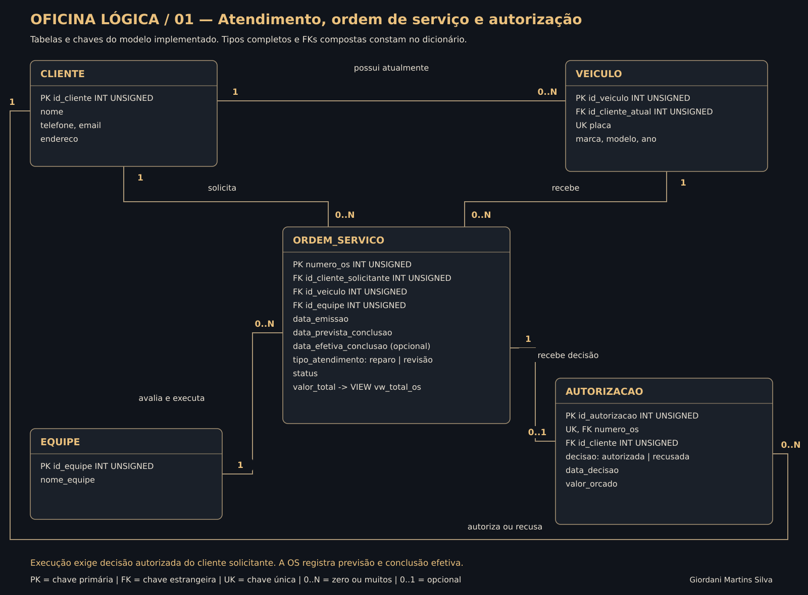
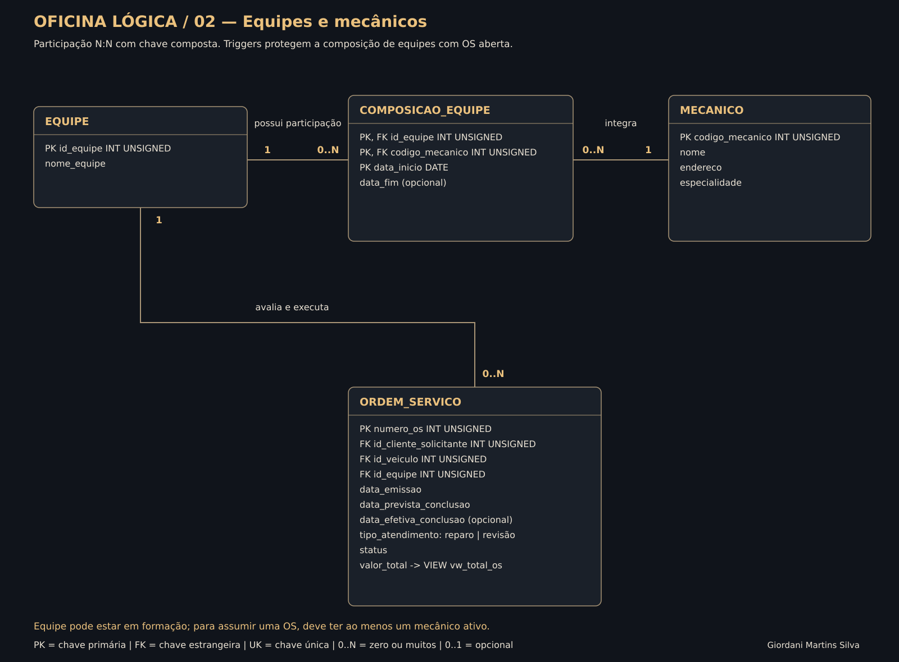
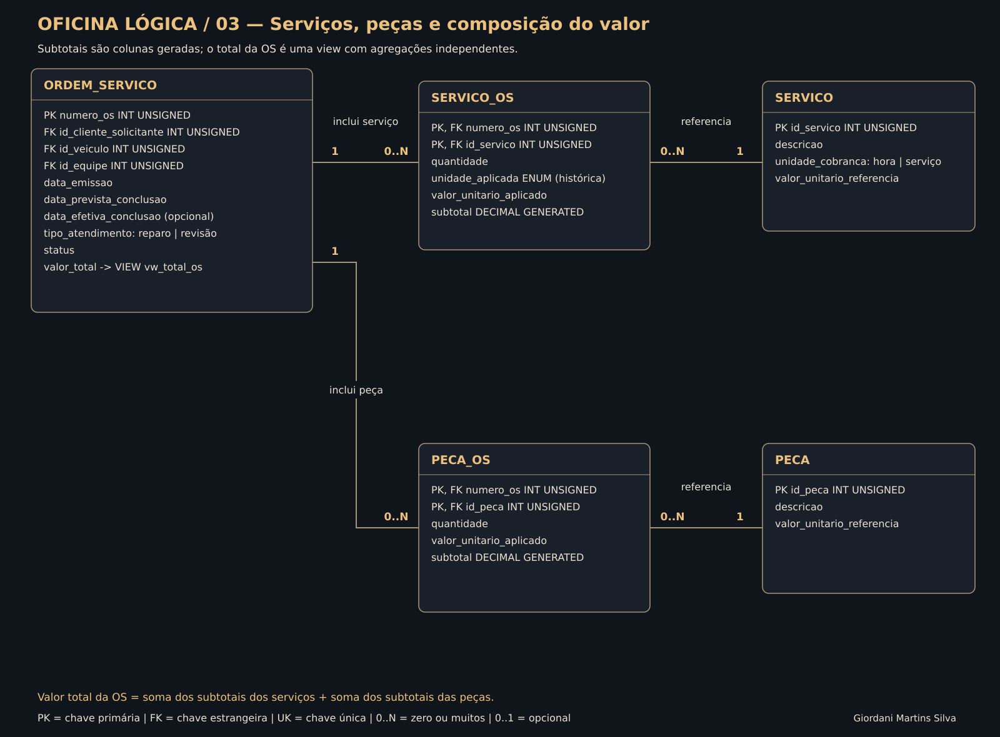

# Projeto lógico de banco de dados — Oficina mecânica

**Autor:** Giordani Martins Silva  
**Formação:** SQL Database Specialist — DIO  
**SGBD utilizado:** MySQL Community Server 8.4.6, tabelas InnoDB.

Este projeto transforma o [modelo conceitual da oficina](https://github.com/1giordani/aula-git/tree/projeto-oficina-conceitual/projeto-oficina-conceitual) em um esquema relacional executável. Ele administra clientes, veículos, equipes, mecânicos, ordens de serviço, autorização do cliente e itens de mão de obra e peças.

A entrega inclui esquema lógico, criação do banco, regras de integridade, persistência de dados fictícios, 14 perguntas respondidas por SQL e testes reais. Os requisitos são os do enunciado enviado pelo usuário, com [referência ao desafio DIO](https://web.dio.me/lab/construa-um-projeto-logico-de-banco-de-dados-do-zero/learning/e22c99ed-c252-4f0e-8787-62b89b68f83f?back=/track/formacao-sql-db-specialist).

## Esquema lógico







Os três recortes representam o mesmo banco. Os nomes nas caixas correspondem às tabelas SQL; tipos completos, nulabilidade e chaves compostas estão no [dicionário físico](docs/DICIONARIO.md), extraído do MySQL executado. A linha `valor_total -> VIEW vw_total_os` indica um valor calculado na view, não uma coluna armazenada na tabela ordem_servico.

O arquivo [oficina_logica.drawio](diagramas/oficina_logica.drawio) contém as três páginas editáveis. Baixe-o e abra em diagrams.net para alterar o esquema.

## Estrutura e decisões

- **11 tabelas:** cliente, veiculo, equipe, mecanico, composicao_equipe, ordem_servico, autorizacao, servico, servico_os, peca e peca_os.
- **Chaves compostas:** participações de mecânicos e itens de serviços/peças.
- **Mesma equipe:** a OS possui um único id_equipe imutável; composição fica bloqueada enquanto houver OS aberta.
- **Solicitante histórico:** a OS preserva o cliente que a abriu, mesmo se o veículo mudar de proprietário depois.
- **Autorização:** a FK composta vincula a decisão ao solicitante correto. Os gatilhos verificam valor, data, estado e aprovação para execução.
- **Orçamento congelado:** itens só mudam durante avaliação; o envio para autorização exige pelo menos um serviço.
- **Preço e unidade históricos:** copiados das referências para o item na inclusão. Alterações no catálogo não mudam OSs anteriores.
- **Valores derivados:** subtotal é coluna gerada; o total é a soma, em view, de serviços e peças agregados separadamente.

As restrições de estado e integridade são detalhadas em [regras implementadas](docs/REGRAS_IMPLEMENTADAS.md). O banco não inclui pagamentos nem estoque: o valor das OSs é um indicador de orçamento/trabalho, não de dinheiro recebido.

### Por que uma view para o total?

Um JOIN direto entre serviços e peças de uma OS pode multiplicar linhas e duplicar a soma. Em `vw_total_os`, cada conjunto é agregado por numero_os antes das junções. Ordens sem itens retornam zero com COALESCE. Isso mantém o total consistente sem uma coluna que precisaria ser atualizada manualmente.

O exemplo testado com dois serviços e duas peças resulta em R$ 430,00 de serviços e R$ 360,00 de peças: **R$ 790,00** ao todo.

## Perguntas e cláusulas SQL

Todas as perguntas abaixo têm uma consulta identificada em `sql/04_consultas.sql`.

| Consulta | Pergunta | Recursos principais |
| --- | --- | --- |
| Q01 | Quais mecânicos e especialidades estão cadastrados? | SELECT, ORDER BY |
| Q02 | Quais OSs abertas estão atrasadas? | WHERE, DATEDIFF, atributo derivado, ORDER BY |
| Q03 | Qual o custo de cada serviço aplicado? | JOIN, expressão aritmética, ROUND |
| Q04 | Qual o valor de serviços, peças e total por OS? | View, COALESCE, SUM, ORDER BY |
| Q05 | Quais clientes têm ao menos duas OSs? | JOIN, GROUP BY, HAVING |
| Q06 | Quantas OSs e qual o valor por equipe, incluindo equipes vazias? | LEFT JOIN, COUNT, SUM, GROUP BY |
| Q07 | Qual a visão completa do atendimento e da autorização? | Múltiplos JOINs, LEFT JOIN, COALESCE |
| Q08 | Quais clientes ainda não possuem OS? | Subconsulta correlacionada, NOT EXISTS |
| Q09 | Quais peças foram usadas em ordens concluídas? | JOIN, WHERE, SUM, GROUP BY |
| Q10 | Quais mecânicos estão em cada equipe na data escolhida? | LEFT JOIN com filtro temporal, GROUP_CONCAT |
| Q11 | Quais preços históricos diferem do catálogo atual? | JOIN, WHERE, diferença calculada |
| Q12 | Quais trabalhos concluídos terminaram depois da previsão? | WHERE, DATEDIFF, ORDER BY |
| Q13 | Qual o ranking dos clientes por valor de ordens não canceladas? | CTE, LEFT JOIN, DENSE_RANK |
| Q14 | Quais serviços acumulam pelo menos R$ 300 em OSs aprovadas? | JOIN, WHERE, GROUP BY, HAVING |

Assim, a entrega cobre SELECT, WHERE, atributos derivados, ORDER BY, HAVING e junções, além de CTE, funções de janela e subconsultas. As consultas usam a data fixa **19/10/2026** para produzir resultados reproduzíveis; altere `@data_referencia` se desejar outra análise.

## Dados e resultados esperados

A massa tem cinco clientes, seis veículos, três equipes, cinco mecânicos e seis OSs em diferentes estados. Todos os dados são fictícios.

| OS | Estado final da carga | Serviços | Peças | Total |
| --- | --- | ---: | ---: | ---: |
| 1001 | CONCLUIDA | 120,00 | 160,00 | 280,00 |
| 1002 | EM_EXECUCAO | 300,00 | 200,00 | 500,00 |
| 1003 | AGUARDANDO_AUTORIZACAO | 250,00 | 200,00 | 450,00 |
| 1004 | EM_AVALIACAO | 0,00 | 0,00 | 0,00 |
| 1005 | CANCELADA | 120,00 | 0,00 | 120,00 |
| 1006 | CONCLUIDA | 550,00 | 200,00 | 750,00 |

A OS 1002 está quatro dias atrasada em 19/10/2026. A 1006 foi concluída um dia depois da previsão. A Cliente Eva ainda não tem OS, e uma equipe está em formação, sem participantes ou ordens. A carga altera a referência de um serviço de R$ 120,00 para R$ 130,00 após as inclusões para comprovar a preservação do preço antigo.

## Executar no computador

Requisitos: MySQL Server 8.0.16+ ou 8.4, cliente mysql ou MySQL Workbench e uma conta de laboratório com permissões para criar o banco, tabelas, view e gatilhos. Use modo SQL estrito; a execução validada utilizou o padrão do MySQL 8.4. Python 3 é necessário somente para o teste automatizado e a regeneração dos diagramas.

Em um servidor sem o banco `oficina_logica`, execute no Workbench, uma vez e nesta ordem:

1. `sql/01_estrutura.sql`
2. `sql/02_regras.sql`
3. `sql/03_dados.sql`
4. `sql/04_consultas.sql`
5. Opcional: `sql/05_fluxo_exemplo.sql`, que demonstra o fluxo completo e usa ROLLBACK para preservar a massa.

Os scripts não removem bancos já existentes. Não repita a carga sobre a mesma base nem execute o teste automatizado depois da criação manual no mesmo servidor.

Alternativa no terminal CMD do Windows ou Bash:

```sh
mysql -u root -p < sql/01_estrutura.sql
mysql -u root -p < sql/02_regras.sql
mysql -u root -p < sql/03_dados.sql
mysql -u root -p < sql/04_consultas.sql
```

O redirecionamento `<` desses exemplos não funciona da mesma forma no PowerShell; nele, use o Workbench ou o teste Python.

### Teste automatizado

Em um servidor de laboratório vazio para este projeto, copie `mysql-local.example.ini` para `mysql-local.ini` e configure as credenciais. Esse arquivo com a senha é ignorado pelo Git.

```sh
python scripts/testar_projeto.py --config mysql-local.ini
```

Se necessário, acrescente `--mysql` com o caminho completo do cliente mysql. O teste cria o banco, carrega os dados, executa e verifica as consultas e confere os erros esperados. Ele mantém os dados de demonstração ao terminar.

Os testes passaram no MySQL 8.4.6. Os resultados estão em `evidencias/`, e o escopo está em [validação](docs/VALIDACAO.md). Não foram realizados testes de carga ou concorrência.

## Organização

- `sql/`: estrutura, regras, dados, consultas e exemplo transacional.
- `diagramas/`: três SVGs e Draw.io editável.
- `docs/`: dicionário extraído do banco, regras e validação.
- `evidencias/`: resultados reais e metadados da execução.
- `scripts/testar_projeto.py`: teste de integração.
- `scripts/gerar_diagramas.py` e `modelo_logico.json`: fonte reproduzível das imagens.

## Entrega na DIO

**Link para entregar:**

https://github.com/1giordani/aula-git/tree/projeto-oficina-logico/projeto-oficina-logico

**Descrição para copiar:**

> Projeto lógico de banco de dados MySQL para uma oficina mecânica, desenvolvido a partir do modelo conceitual anterior. Inclui 11 tabelas com chaves e restrições, dados fictícios, autorização de ordens de serviço e cálculo de custos de serviços e peças. Apresenta 14 consultas com SELECT, WHERE, atributos derivados, ORDER BY, HAVING e JOIN, além de CTE e ranking. Os scripts foram executados e testados no MySQL 8.4, com diagramas, documentação e evidências no GitHub.
